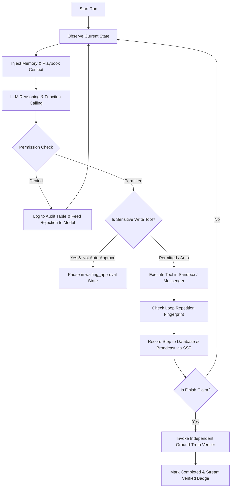

# CentrAlign Autonomous AI Workforce Runtime Architecture

This document maps the prototype architecture directly to the CentrAlign AI workforce layer, detailing design decisions, state machines, reliability guarantees, and verification mechanics.

---

## 1. Platform Mapping Table

| CentrAlign Platform Layer | Our Implementation | Key Files |
| :--- | :--- | :--- |
| **Reasoning Engine** | Generic Gemini function-calling loop with compact text snapshots & exponential backoff on 429/5xx | `app/agent/loop.py`, `app/agent/llm.py` |
| **Workflow Engine** | Ordered role playbooks (goals & exit criteria) loaded dynamically from YAML | `app/roles/recruiter.yaml`, `app/roles/analyst.yaml` |
| **Company Memory** | Per-run key-value facts stored in DB `memory_facts` + rolling summary | `app/agent/memory.py` |
| **Knowledge Retrieval** | Postgres Full-Text Search (`tsv TSVECTOR`) over company policy docs, hiring rubrics & scheduling protocols | `app/knowledge/search.py` |
| **Permission Layer** | Pre-execution code interceptor enforcing allowed tools, allowed apps, and write guards with audit logging | `app/agent/permissions.py` |
| **Human Escalation** | `ask_user` (clarification) and `request_approval` (manager authorization) via Web Console & Telegram | `app/agent/tools.py`, `app/api/runs.py` |
| **Tool Execution** | HTTP Browser with session cookies, Telegram Messenger, Demo Vault, Finish claim builder | `app/agent/browser.py`, `app/messaging/` |
| **Observability** | Step-by-step audit logging, realtime Server-Sent Events (SSE) streaming, live UI timeline | `app/api/runs.py`, `frontend/src/app/runs/` |
| **Ground-Truth Verifier** | Independent verifier inspecting Postgres state directly — never relying on agent self-claims | `app/agent/verifier.py` |

---

## 2. Core Execution Loop (`app/agent/loop.py`)

The agent loop operates as an asynchronous background worker implementing a strict observe-reason-act cycle:

### Loop Guards
- **Step Cap**: Hard limit of 40 steps prevents infinite execution.
- **Wall Time Cap**: 300-second maximum duration.
- **Loop Repetition Detector**: Tracks action fingerprints `MD5(tool + args + current_page_url)`. If the same signature repeats 3 times, a system intervention message instructs the agent to change strategy or escalate via `ask_user`.

---

## 3. Sandboxed Company Applications

Instead of relying on mocked API calls, the agent operates inside two real server-rendered web applications hosted in the FastAPI backend:

1. **ATS Portal (`/sandbox/ats/`)**:
   - Cookie-based authentication (`ats_session`).
   - Job requisitions with JD text and hidden ground truth (`expected_shortlist_ids`).
   - Applicant resume inspection, stage progression (`Applied` &rarr; `Shortlisted` &rarr; `Intent Confirmed` &rarr; `Interview Scheduled`, or `Rejected`).
   - Enforces business logic: stage order constraints, numeric validation on expected CTC.

2. **Interview Calendar (`/sandbox/calendar/`)**:
   - Cookie-based authentication (`cal_session`).
   - 45-minute weekday interview slots.
   - Enforces conflict avoidance: no double-booking and candidate must be in `Intent Confirmed` stage before scheduling.

3. **HTTP Browser Snapshot Generator (`app/agent/browser.py`)**:
   - Emulates human browsing via `httpx.AsyncClient` with persistent cookies.
   - Parses HTML into compact, token-efficient text snapshots with numbered interactive elements (`[L1]` for links, `[F1]` for forms). Never sends raw HTML to the model, protecting token budgets.

---

## 4. Reliability & Error Recovery Matrix

Errors are classified by `app/agent/errors.py` into distinct categories with recommended recovery routines:

| Error Category | Triggering Condition | Recovery Routine |
| :--- | :--- | :--- |
| **`auth_expired`** | 401 / Session Expired | Re-read vault credentials and re-authenticate via `/login`. |
| **`transient`** | 500 / 502 / Network Timeout | Exponential backoff retry with jitter (up to 2 times). |
| **`slot_conflict`** | Slot taken by race condition | Re-read calendar overview and select the next available free slot. |
| **`validation`** | Non-numeric CTC (e.g. "18 lakhs") | Parse error message, reformat to numeric figure `18`, and resubmit. |
| **`selector_missing`** | Form or link ID not in snapshot | Call `web_read` to refresh DOM state and locate updated element ID. |
| **`permission_denied`** | Role restriction violation | Halt workaround attempts; report policy boundary to supervisor. |
| **`no_reply`** | Candidate uncontactable | Send one polite nudge, then record unresponsiveness. |

---

## 5. Independent Ground-Truth Verifier (`app/agent/verifier.py`)

A fundamental tenet of the runtime is: **Never trust the agent's self-reported memory**. 

When the agent calls `finish`, it supplies typed claims. The independent verifier connects directly to Postgres and executes read-only checkers:

- `shortlist_valid(job_id, applicant_ids)`: Verifies that shortlisted applicants belong to the seeded ground truth (`jobs.expected_shortlist_ids`).
- `intent_matches_reply(applicant_id)`: Checks that recorded notice period and CTC match candidate response.
- `policy_respected(applicant_id)`: Asserts no interviews are booked for candidates with notice periods exceeding 60 days or candidates who declined.
- `interview_booked(applicant_id, slot_id)`: Asserts exactly 1 interview is booked, slot not double-booked, and applicant completed prerequisites.
- `stage_is(applicant_id, stage)`: Verifies the exact stage in the ATS database table.
- `no_booking(applicant_id)`: Verifies that no calendar slot or interview record exists.
- `count_applicants(job_id, expected_count)`: Evaluates quantitative queries for the Analyst role.
- `permission_denied_logged(run_id)`: Asserts that blocked write attempts were recorded in `audit_log`.
